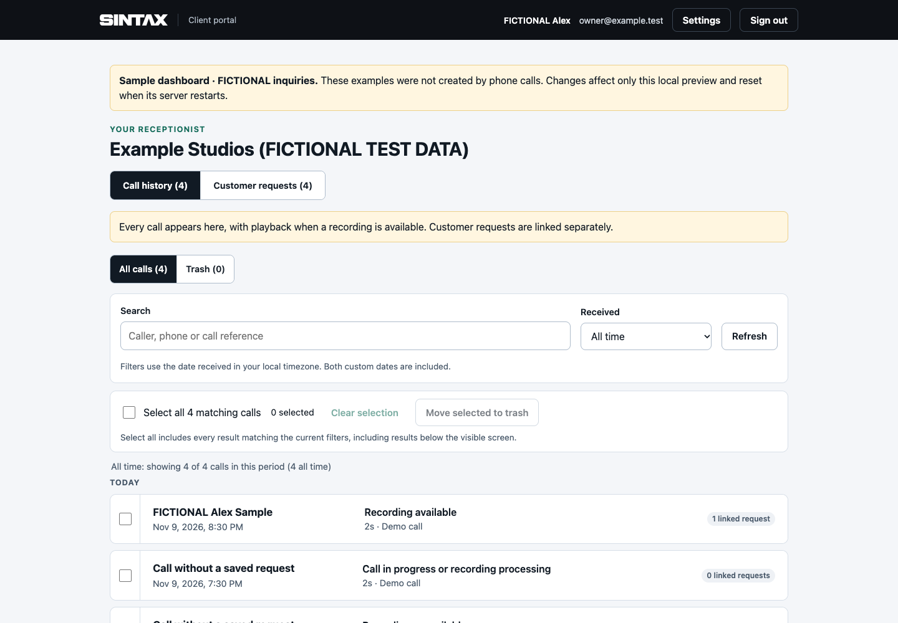
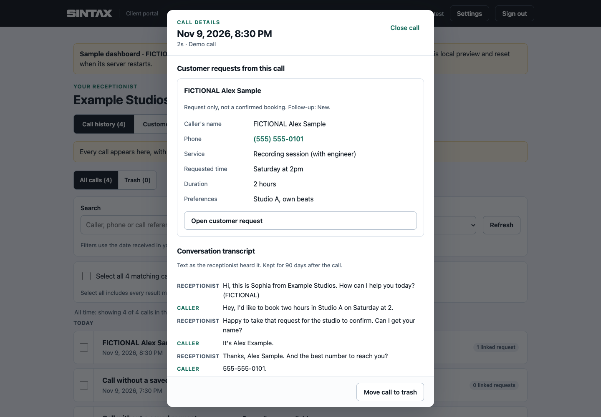
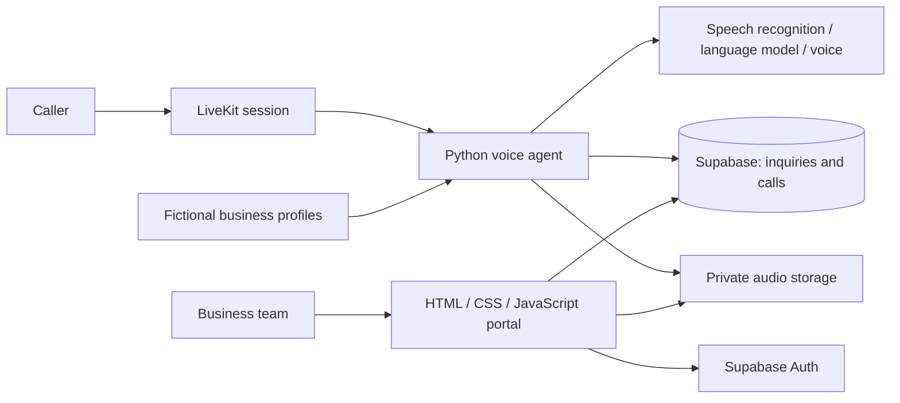

# SINTAX

**Work in progress · Voice AI reception + a client portal · MIT licensed**

SINTAX connects a voice receptionist to a business's follow-up workflow: understand a caller's request, confirm the details, save an inquiry, and give the team a place to review calls and correct what the AI heard.

Built by Jaison Mathew on the LiveKit Agents Python starter. This public showcase contains the shared application code, tests and **fictional business profiles**. It is an actively developed project, with a runnable local portal demonstration; it is not a turnkey production deployment.



<details>
<summary>See saved request details and the conversation transcript</summary>



</details>

## Try the portal locally

Requires Python 3.10 or newer. No API keys, accounts, database, package installation or paid services are needed for this demonstration.

```bash
git clone https://github.com/sintax-ai/sintax-showcase.git
cd sintax-showcase
python3 client-portal/tests/mock/server.py
```

Open **http://127.0.0.1:4174/?demo=pickleball** or **http://127.0.0.1:4174/?demo=property-services**.

For the studio example and owner settings, open http://127.0.0.1:4174 and sign in with `owner@example.test` / `fictional-password`.

All callers, businesses and conversations are fictional. Edits live in memory and reset when the server restarts. Audio playback uses a generated tone, not a person's recording. This test server binds to localhost and must not be deployed as a public service.

## What I built

- **A shared voice-agent engine:** per-business configuration, keypad routing, explicit intake enablement, and separate demo and pilot modes.
- **Confirmed inquiry capture:** validation and caller confirmation before saving; successful persistence before claiming a request was saved.
- **Calendar grounding:** timezone-aware date interpretation, clarification for ambiguous dates, and checks before speaking date confirmations.
- **Reliable call endings:** deterministic farewell playback before SDK-managed disconnect.
- **A client portal:** call history, saved details and transcripts before optional audio, editable requests, filtering, CSV exports, trash/restore, account settings and alert preferences.
- **Database access controls:** membership-scoped row-level security, frozen original captures, guarded edits and private audio access.
- **Tests for failure cases:** competing edits, expired sessions, cross-business access, routing, storage errors and calendar edge cases.

The starter provides the LiveKit foundation; the business workflows, portal and related tests are the SINTAX application work. Third-party packages remain under their respective licenses. See [attribution](THIRD_PARTY_NOTICES.md).

## How the pieces fit



For the local demonstration, a Python mock server replaces Supabase and supplies fictional records. No voice session is started.

## Interesting engineering decisions

| Decision | Why |
| --- | --- |
| Enforce business separation in the database | A hidden UI element is not an access boundary. |
| Keep the AI's original capture alongside corrections | Owners can fix mistakes without losing what was originally heard. |
| Reject stale edits | Two people should not silently overwrite each other's changes. |
| Separate calls from saved requests | A call does not necessarily create an inquiry, and an inquiry is not a confirmed booking. |
| Load audio only on request | Saved details and text remain useful even when recording playback is unavailable. |
| Queue alerts from database writes | Notification delivery should not block the voice conversation. |

See [architecture and tradeoffs](docs/architecture.md) for the implementation paths and known limits.

## Project status

**Implemented in the included code:** agent routing and intake, date tools, call history, transcript handling, portal editing/settings, database permissions, and local regression suites.

**Demonstrated here:** an entirely fictional portal, local agent unit tests, and database tests using an isolated in-memory PostgreSQL runtime.

**Still needs work for a new deployment:** a reproducible initial Supabase schema, provider/account setup, recording and retention decisions, real call evaluation, reliable notification delivery, and deployment-specific configuration. The historical SQL migrations assume initial tables that originally existed outside version control. The test baseline is a test approximation, not a production installer.

The example voice IDs are placeholders. Live voice calls require your own LiveKit project, supported models and voice, provider access and usage charges. See the [agent setup notes](studio-agent/README.md). Availability lookup, confirmed booking, payments and dispatch are not implemented.

## Run the tests

Use Node.js 22+ for the portal checks and [uv](https://docs.astral.sh/uv/) with Python 3.14 for the agent's pinned dependency set.

```bash
# Portal logic and isolated database checks
cd client-portal/tests
npm ci
npm test
npm run db
cd ../..

# Fictional portal HTTP behavior
python3 -m unittest discover -s client-portal/tests/mock -p 'test_*.py'

# Agent tests: no API credentials or live inference
cd studio-agent
uv sync --locked --python 3.14
uv run --locked pytest
```

## Updates and reuse

This is a curated public snapshot. Meaningful updates land as ordinary commits in this repository; see the [changelog](CHANGELOG.md) and [maintenance guide](docs/maintenance.md). Private client configuration and operational history are excluded.

The code is available under the [MIT license](LICENSE). You can use it commercially or as a starting point for your own project, subject to the license notices.
